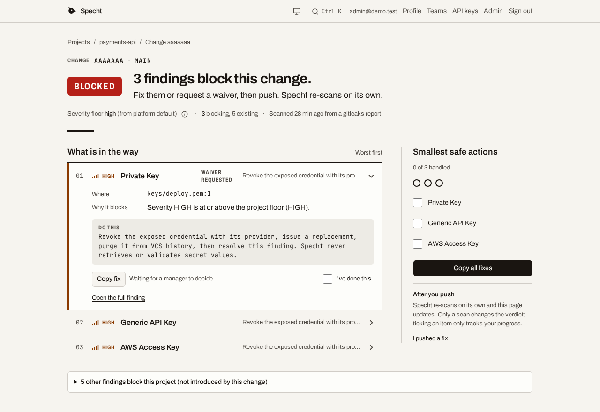
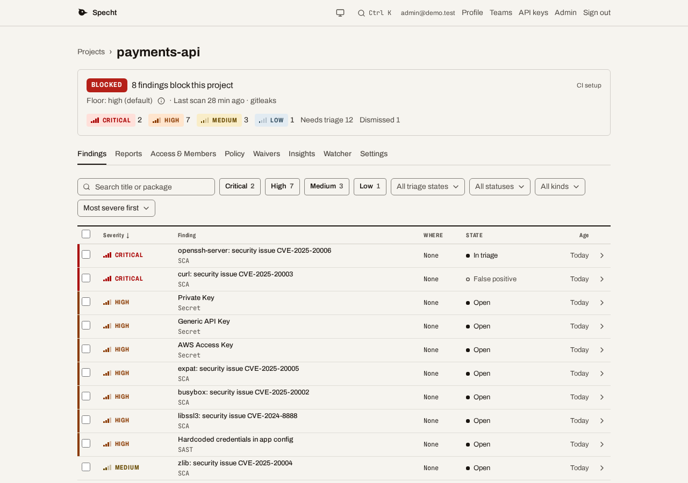
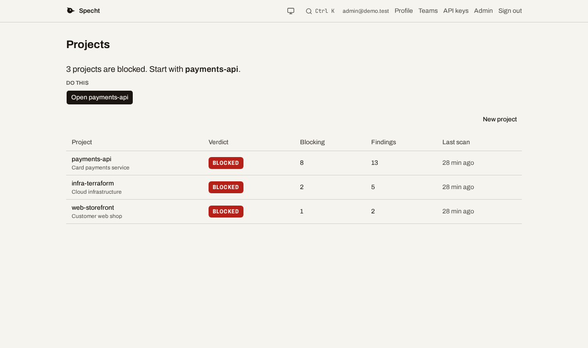
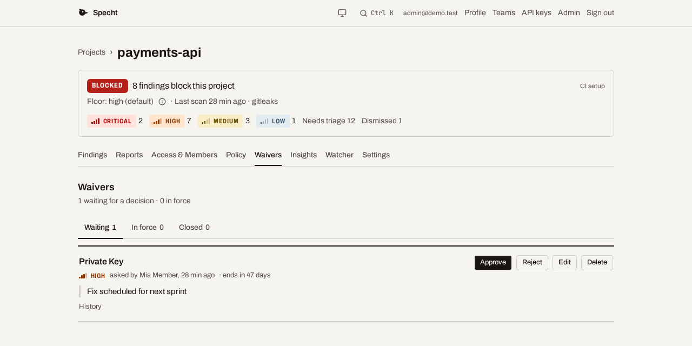

# Specht

[](https://github.com/minh-tg/specht/actions/workflows/ci.yml) [](LICENSE)

Specht collects the reports your security scanners already produce, tracks each
finding across scans, and tells your CI whether a change should merge. It is one
Go server with a Postgres database and a web UI, and you host it yourself.

> [!WARNING]
> **Experimental preview.** There is no tagged release yet, and APIs, database
> schemas and settings can change. Do not make Specht your only security control.



The page a CI link opens: what the change introduced, where, and what to do about it.

| Findings and their triage state | Projects and their verdicts | A waiver waiting for a decision |
| --- | --- | --- |
|  |  |  |

## What it does

- **Keeps findings across scans.** A finding is open, fixed, returned or waived,
  and keeps its history. Scanning again updates findings instead of duplicating them.
- **Gates changes in CI.** `specht-adapter` and the GitHub Action fail a build when
  the project policy blocks it, print annotations, and can publish a check run.
- **Explains a block.** The failing check links to a page that shows what the change
  introduced and how to fix it.
- **Handles triage and exceptions.** Bulk triage, reachability decisions, per-project
  policy with shared templates, and waivers with an expiry date and an approval step.
- **Watches for new advisories.** A background job checks tracked packages against OSV
  and notifies Slack or a webhook.
- **Fits your sign-in.** Local accounts or OIDC single sign-on, teams, and API keys
  with scopes.
- **Talks to AI assistants.** `specht-mcp` is an MCP bridge that is read-only unless
  you opt in. See [`docs/mcp.md`](docs/mcp.md).

## Quick start

You need Docker with the compose plugin. There is no published image until the first
release, so this builds the server from source.

```bash
git clone https://github.com/minh-tg/specht.git
cd specht
cp deploy/.env.prod.example deploy/.env.prod
```

Edit `deploy/.env.prod`. Set `POSTGRES_PASSWORD` and `JWT_SECRET` (at least 32 random
bytes, for example `head -c 48 /dev/urandom | base64`), and uncomment `SETUP_TOKEN` with a
value of your choice, at least 16 characters. Then start the stack:

```bash
docker compose -f deploy/docker-compose.yml -f deploy/docker-compose.build.yml \
  --env-file deploy/.env.prod up -d --build
```

Open <http://localhost:8080>, enter the setup token, and create the first administrator.
Create a project, then follow its CI setup page to make an API key and connect a scanner.

[`deploy/README.md`](deploy/README.md) covers TLS, backups, upgrades and every setting.
The defaults above suit an evaluation, not an internet-facing deployment.

## Connect your CI

Store the project's API key as the `SPECHT_API_KEY` repository secret, then add the
gate after your scan:

```yaml
- name: Gate with Specht
  uses: minh-tg/specht@vX.Y.Z
  with:
    api-url: https://specht.example.com
    api-key: ${{ secrets.SPECHT_API_KEY }}
    project: my-app
    file: trivy-results.json
    tool: trivy
```

The action downloads the `specht-adapter` for the release tag you pin, verifies its
signature, and runs it to upload the report and evaluate the gate. The adapter and the
server must be the same release, so pin the tag that matches your server. The step exits `0` when the
gate passes, `1` when a severity threshold is breached, and `2` on a runtime error.

Complete pipelines for GitHub Actions and GitLab are in [`examples/ci/`](examples/ci/).

## Supported scanners

| Kind | Tools |
| --- | --- |
| Dependencies and container images | Trivy, OSV-Scanner, Grype, OWASP Dependency-Check |
| Source code | Semgrep (JSON or SARIF), any SARIF 2.1.0 tool such as CodeQL, Gosec or Hadolint |
| Infrastructure as code | Checkov, tfsec, Trivy |
| Secrets | Gitleaks, Trivy |
| Web applications | Nuclei |
| Software bills of materials | CycloneDX 1.x JSON, SPDX 2.x JSON |

Choose the scanner that matches the tool that wrote the file, on the upload page or with
`-tool` in the adapter. A file from another tool is refused, and the message names the
scanner it looks like. The SBOM scanner records package identity but does not yet
normalize dependency graphs, licenses, hashes or signatures.

<details>
<summary>The command that produces each file</summary>

The table is generated from the parsers, so it lists exactly what they read.

<!-- scanners:start -->
| Scanner | Files it reads | How to produce one | Checked with |
|---|---|---|---|
| **Trivy** | JSON (`.json`) | `trivy fs --format json -o trivy.json .` | Trivy 0.74.0 |
| **OSV-Scanner** | JSON (`.json`) | `osv-scanner scan source --format json --output-file osv.json .` | OSV-Scanner 2.6.0 |
| **Semgrep** | JSON (`.json`)<br>SARIF (`.json`, `.sarif`) | `semgrep scan --json -o semgrep.json`<br>`semgrep scan --sarif -o semgrep.sarif` | Semgrep 1.172.0 |
| **Checkov** | JSON (`.json`) | `checkov -d . -o json > checkov.json` | Checkov 3.3.29 |
| **OWASP Dependency-Check** | JSON (`.json`) | `dependency-check --scan . --format JSON --out .` | Dependency-Check 12.1.0 |
| **Grype** | JSON (`.json`) | `grype dir:. -o json > grype.json` | Grype 0.120.1 |
| **SBOM (CycloneDX or SPDX)** | CycloneDX JSON (`.json`)<br>SPDX JSON (`.json`) | `syft dir:. -o cyclonedx-json=sbom.json`<br>`syft dir:. -o spdx-json=sbom.json` | Syft 1.54.0, Trivy 0.74.0, Grype 0.120.1<br>Syft 1.54.0 |
| **SARIF (any tool)** | SARIF 2.1.0 (`.sarif`, `.json`) | `gosec -fmt sarif -out gosec.sarif ./...` | CodeQL 2.27.0, Gosec 2.29.0, Hadolint 2.14.0, Trivy 0.74.0 |
| **Gitleaks** | JSON (`.json`) | `gitleaks detect --report-format json --report-path gitleaks.json` | Gitleaks 8.30.1 |
| **tfsec** | JSON (`.json`) | `tfsec . --format json --out tfsec.json` | tfsec 1.28.14 |
| **Nuclei** | JSON Lines (`.jsonl`, `.ndjson`) | `nuclei -u https://example.com -jsonl -o nuclei.jsonl` | Nuclei 3.11.1 |

- **Trivy**: `trivy image` and `trivy config` write the same format.
- **Semgrep**: Both formats give the same findings.
- **Checkov**: A run over several kinds of files, such as Terraform and Kubernetes, writes one report per framework; all of them are read. Checkov's open-source output has no severity, so its findings show as unknown.
- **Grype**: Its CycloneDX output (`-o cyclonedx-json`) goes to the SBOM scanner.
- **SBOM (CycloneDX or SPDX)**: A CycloneDX file that lists vulnerabilities, such as Grype's, also gives findings.
- **SARIF (any tool)**: For tools without a scanner of their own here, such as Gosec, Hadolint (`--format sarif`) and CodeQL. Trivy, Grype and Semgrep also write it, but use their own scanner when there is one.
- **Gitleaks**: Reports written with `--redact` are accepted.
- **Nuclei**: One finding per template and URL.
<!-- scanners:end -->

</details>

A format that is not listed needs a Go parser with fixtures and tests under
[`internal/parser/`](internal/parser/).

## Documentation

- [`deploy/README.md`](deploy/README.md): Docker Compose, secrets, TLS, backups, upgrades and the configuration reference.
- [`openapi.yaml`](openapi.yaml): every HTTP route with its required role, API key scope, parameters and responses.
- [`docs/mcp.md`](docs/mcp.md): connecting an AI assistant.
- [`CHANGELOG.md`](CHANGELOG.md): what changed in each release.
- [`CONTRIBUTING.md`](CONTRIBUTING.md): building from source, running the tests and sending a change.

## Feedback and security

Bug reports and ideas go to [GitHub issues](https://github.com/minh-tg/specht/issues).
Report vulnerabilities as [`SECURITY.md`](SECURITY.md) describes.

## License

[GNU Affero General Public License v3.0](LICENSE).
